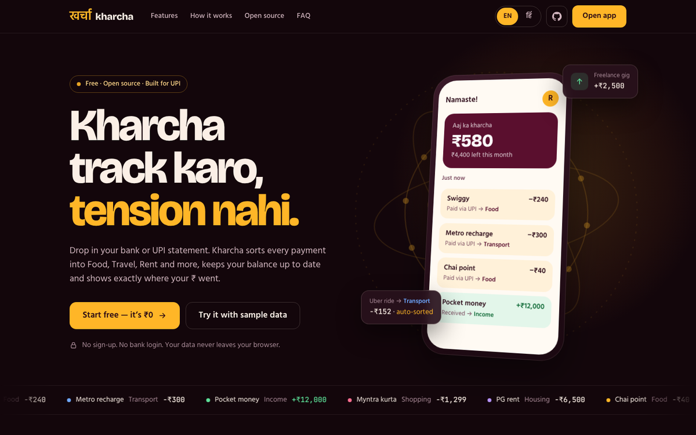
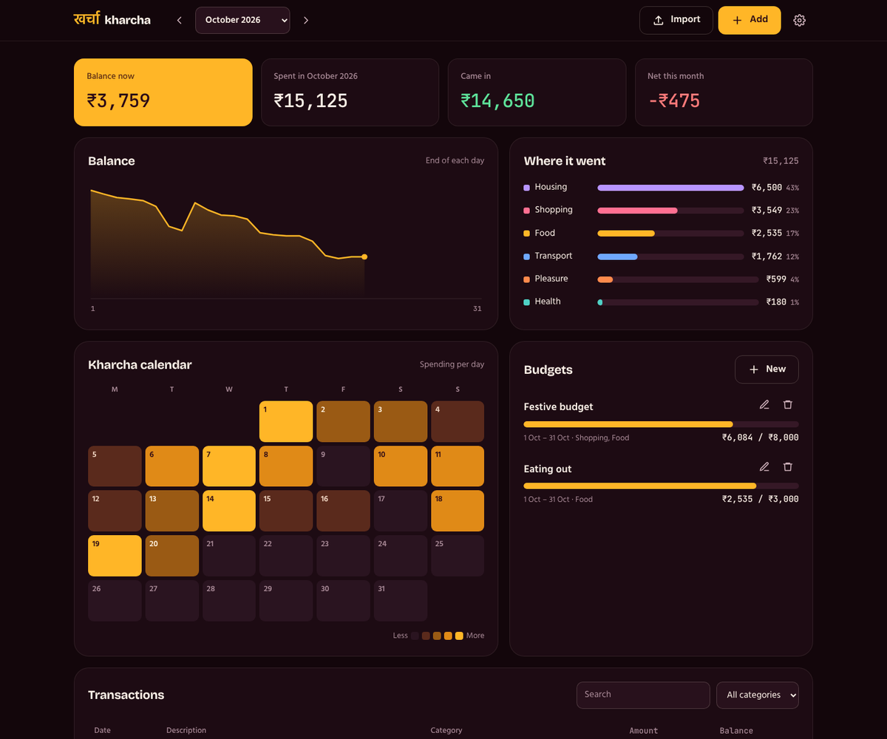

<p align="center">
  
</p>

<h1 align="center">खर्चा · Kharcha</h1>

<p align="center">
  <b>Kharcha track karo, tension nahi.</b><br>
  A free, open-source expense tracker built for UPI. Import your bank or UPI statement and see where every rupee went.<br>
  No sign-up. No bank login. Your data never leaves your browser.
</p>

<p align="center">
  <a href="https://saniasodhi.github.io/personal-finance-tracker/">Live app</a> ·
  <a href="https://saniasodhi.github.io/personal-finance-tracker/app/?sample=1">Try with sample data</a> ·
  <a href="CONTRIBUTING.md">Contribute</a>
</p>

---

## Features

- **Import any statement**: CSV or `.xlsx` from any bank or UPI app. Handles `Debit`/`Credit` columns, `DD/MM/YYYY` dates, `₹1,20,000` amounts, newest-first statements and header blurbs above the table.
- **Auto-categorized**: Food, Transport, Shopping, Housing, Health, Pleasure, Income. Keywords cover Indian merchants (Swiggy, Zomato, Blinkit, Rapido, IRCTC, Myntra…). Change a category and your choice is kept.
- **Balance that fills itself**: set a starting balance once; every expense and income updates what's left.
- **Monthly dashboard**: balance over the month, spend by category, money in vs out.
- **Kharcha calendar**: a heatmap of spending per day.
- **Budgets**: monthly, festive (Diwali, weddings, trips) or per category, with progress bars.
- **English or हिंदी** on the landing page.
- **Private by design**: everything is stored in your browser's `localStorage`. There is no backend, no analytics and no third-party requests (fonts are bundled).
- **Export to CSV** anytime, in the same format the command-line tool uses.

<p align="center">
  
</p>

## Run it locally

```bash
cd web
npm install
npm run dev      # http://localhost:5173
npm test         # unit tests for import, categories, balances, budgets
npm run build    # static site in web/dist
```

The build is a plain static site, so it can be hosted anywhere: GitHub Pages (a workflow is included), Vercel, Netlify or Cloudflare Pages.

## Project layout

```
web/
  index.html            landing page
  app/index.html        the tracker
  src/core/             pure TypeScript: import, categorize, ledger maths, storage (tested)
  src/landing/          landing page + EN/हिंदी strings
  src/app/              dashboard, charts, dialogs
tracker.py, categorize.py   original Python command-line tool
data/sample_transactions.csv
```

## Command-line tool

The original Python CLI still works and reads/writes the same CSV columns as the web app's export:

```bash
pip install -r requirements.txt
python tracker.py import data/sample_transactions.csv
python tracker.py add --date 2025-08-06 --cat - --desc "Swiggy" --spent 240
python tracker.py income --date 2025-08-07 --desc "Pocket money" --amount 3000
python tracker.py summary --month 2025-08
```

## Roadmap

- [ ] Hindi in the dashboard (the landing page is already bilingual)
- [ ] Custom categories and keyword rules
- [ ] Recurring transaction detection
- [ ] Installable PWA with offline support
- [ ] Optional encrypted sync between devices

Ideas and bank formats that don't import cleanly are welcome as [issues](https://github.com/saniasodhi/personal-finance-tracker/issues).

## License

[MIT](LICENSE)
